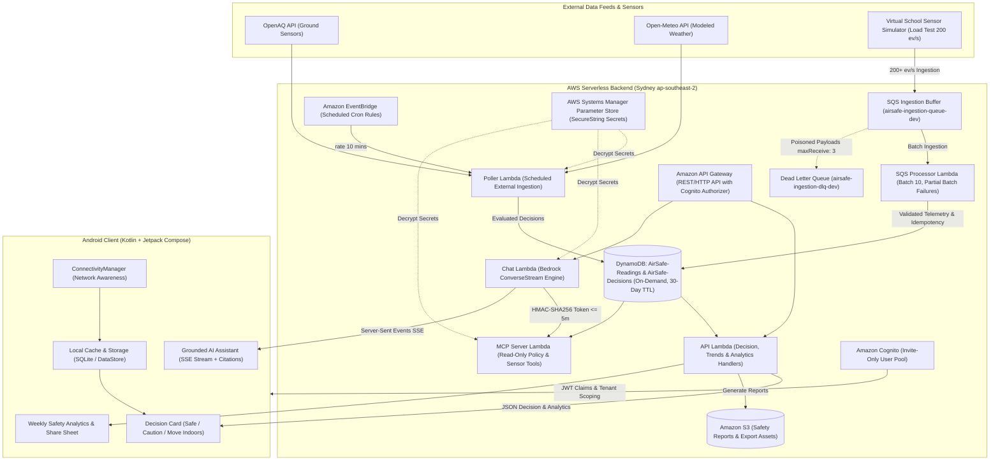

# AirSafe Schools — Cloud & System Architecture Documentation

> **Status:** Authoritative Architectural Specification  
> **Revision:** 2.0 (Step 6.3 Update)  
> **Region:** AWS Sydney (`ap-southeast-2`)  
> **Target Environment:** 100% Serverless, Zero-Idle-Spend Architecture  

---

## 1. Executive Architectural Summary

**AirSafe Schools** provides a policy-grounded decision engine and mobile application designed to protect schoolchildren across Bangladesh from extreme heatwaves and toxic air pollution. Operating in resource-constrained environments with intermittent cellular connectivity, the system delivers sub-2-second environmental safety determinations (**SAFE**, **CAUTION**, **MOVE INDOORS**) governed by the authoritative *Model School Outdoor Activity Policy v1.2*.

The cloud architecture is designed from first principles to guarantee:
1. **Zero-Idle-Spend Guarantee:** Complies with a strict **$100 total AWS credit budget** with projected recurring costs of **$5.28/month for 100 schools** ($0.00 standing idle cost).
2. **Monotonic Policy Floor:** Mathematical safety invariants ensure AI recommendations and human coordinator overrides can tighten restrictions, but can never soften them below official health thresholds.
3. **Offline-First Resilience:** Zero-lag UI rendering on physical Android devices backed by local SQLite/Room caching and network transition awareness.

---

## 2. System Architecture & Component Topology

---

## 3. Advanced AWS Services: Integration Status Matrix

The following matrix documents the implementation status and architectural rationale for every evaluated AWS service in the AirSafe Schools ecosystem:

| AWS Service | Category | Integration Status | Architectural Role & Implementation Scope |
| :--- | :--- | :---: | :--- |
| **Amazon DynamoDB** | Database | **Fully Integrated** | Core single-table storage (`AirSafe-Readings-dev` and `AirSafe-Decisions-dev`) in `PAY_PER_REQUEST` on-demand capacity mode. Employs 30-day automatic Time-To-Live (TTL) expiration, idempotent deduplication markers (`EVENT#<id>`), immutable override audit logs (`OVERRIDE_AUDIT#<iso>`), and composite primary keys. Zero idle cost. |
| **AWS Lambda** | Compute | **Fully Integrated** | Powers all backend compute modules: Telemetry Poller, SQS Batch Ingestion Processor, REST API Dispatcher, Bedrock AI Assistant, and Read-Only MCP Tool Server. Packaged with minimal, tree-shaken TypeScript runtimes achieving sub-300ms cold starts without provisioned concurrency. |
| **Amazon API Gateway (REST/HTTP)** | API Management | **Fully Integrated** | Front-door ingress for the Android client and public baselines. Configured with Cognito JWT authorizers, CORS preflight validation, path routing, and strict schema validation. Operates entirely within the AWS Free Tier (1,000,000 free calls/month). |
| **Amazon S3** | Object Storage | **Fully Integrated** | Stores generated school safety compliance reports, downloadable CSV datasets, and build artifacts. Leverages standard infrequent-access lifecycle rules and server-side encryption (`AES-256`). |
| **Amazon Bedrock** | Generative AI | **Fully Integrated** | Powers the bilingual assistant using Claude 3.5 Sonnet / Claude 3 Haiku via the `ConverseStream` API. Integrated with custom Model Context Protocol (MCP) tool-calling for real-time sensor grounding and deterministic rule-engine fallback when offline or rate-limited. |
| **Amazon EventBridge Scheduler** | Event Orchestration | **Utilized** | Provides serverless cron scheduling (`rate(10 minutes)`) to trigger the external weather and OpenAQ poller Lambda. Replaces continuously running daemons with zero-idle-cost serverless invocations. |
| **REST Streaming (SSE)** | API Streaming | **Utilized** | Implemented as chunked Server-Sent Events (SSE) over HTTP on the `/schools/{schoolId}/assistant/chat` endpoint to stream Bedrock generative tokens interactively to the Android client. |
| **GitHub Actions OIDC** | DevOps & Security | **Utilized** | Configured with AWS IAM OpenID Connect (OIDC) identity federation for automated CI/CD deployments. Eliminates static long-lived AWS Access Keys in repository secrets. |
| **AWS AppSync** | GraphQL & Real-Time | **Omitted** | Deliberately omitted for live telemetry updates in favor of periodic HTTP polling. AppSync enforces continuous WebSocket connection charges and complex reconnection logic unsuited for intermittent Bangladesh mobile networks. |
| **Vector DBs / S3 Vectors** | Vector Search | **Omitted** | Deliberately omitted. Managed vector databases (such as Amazon OpenSearch Serverless) require a minimum standing capacity charge of 2–4 OCUs (~$0.24/OCU-hour = ~$175 to $350/month), which would immediately exhaust the $100 credit ceiling. AirSafe Schools utilizes sub-50ms deterministic in-memory keyword matching and DynamoDB policy indices instead. |
| **AWS X-Ray** | Tracing & Observability | **Omitted (Minimal)** | Active distributed tracing is omitted to prevent per-trace sampling costs and runtime overhead. High-fidelity observability is achieved via structured JSON CloudWatch logs with correlation IDs (`school_id`, `request_id`, `event_id`). |

---

## 4. Architectural Rationale: Polling vs. Real-Time Streaming for Telemetry Updates

A foundational architectural decision in AirSafe Schools is the selection of **deterministic HTTP polling** (supplemented by on-demand manual refresh and push notifications) over persistent real-time streaming (such as WebSockets or AWS AppSync subscriptions) for environmental telemetry and decision card updates.

This design choice is driven by four concrete engineering, economic, and operational factors:

### 1. Strict Adherence to the $100 AWS Credit Budget Ceiling
- **Idle Cost Elimination:** Managed WebSocket services (e.g., API Gateway WebSocket APIs or AWS AppSync) charge for active connection hours and heartbeat messages. Maintaining persistent connections across hundreds of active mobile clients creates continuous background spend even when schools are closed, on vacation, or asleep.
- **AWS Free Tier Maximization:** API Gateway HTTP/REST APIs include **1,000,000 free requests per month**. Polling every 10–15 minutes across 100 schools accounts for approximately **432,000 requests/month**, resulting in **$0.00 API Gateway and Lambda compute costs** within free tier allowances.
- **Zero Idle Capacity:** When schools close at 4:00 PM Asia/Dhaka, query volume drops naturally to zero, resulting in a standing cost of exactly **$0.00/hour**.

### 2. Physical Network Realities in Bangladesh (Intermittent 3G/4G Cellular)
- **High Packet Loss & Frequent Disconnects:** Mobile networks in suburban and rural Bangladesh frequently experience signal attenuation, high jitter, and cell tower handoffs. Persistent TCP WebSockets suffer frequent connection drops, requiring continuous exponential-backoff reconnect storms, heartbeat pings, and connection state recovery.
- **Offline Resilience:** REST polling decouples data retrieval from UI rendering. The Android app caches the latest verified decision locally using Room/SQLite. When connectivity drops, Android's `ConnectivityManager` immediately signals offline status and displays the cached policy decision with a clear "অফলাইন ক্যাশ" (Offline Cache) banner, rather than spinning on broken WebSocket handshakes.

### 3. Temporal Frequency of Environmental Data
- **Physical Sensor Update Cadence:** Ambient air quality (PM2.5, AQI) and meteorological conditions (Heat Index, temperature, relative humidity) change over minutes and hours, not milliseconds. Ground stations and Open-Meteo models update at intervals between **10 and 60 minutes**.
- **Bandwidth & Battery Conservation:** Pushing real-time frames over a WebSocket multiple times per minute transmits 99.9% identical data points, draining student and teacher smartphone batteries and consuming metered cellular data plans with zero improvement to school safety decisions.

### 4. API Gateway REST Payload & Caching Predictability
- **HTTP Caching & Compression:** REST endpoints leverage standard HTTP semantics (`Cache-Control`, `If-Modified-Since`, `ETag`) and gzip compression, reducing mobile payload sizes to under 1.5 KB per decision response.
- **Deterministic Timeout Limits:** REST request-response cycles execute under predictable 29-second API Gateway execution ceilings. This eliminates memory leaks, orphaned socket handles, and connection table bloat on serverless Lambda containers.

---

## 5. Security & Multi-Tenant Isolation Architecture

AirSafe Schools enforces multi-tenant isolation across all architectural layers in accordance with five strict **Hard Gates**:

1. **Hard Gate 1 (Fail-Closed Secrets):** Missing secrets (JWT secrets, API keys, MCP authentication credentials) throw immediate startup exceptions rather than defaulting to hardcoded or insecure fallbacks.
2. **Hard Gate 2 (Cryptographic Tenant Isolation):** Every inbound request requires a valid JWT with an immutable `custom:school_id` claim. Cross-tenant queries (e.g., School A token accessing School B records) are rejected with HTTP 403 Forbidden.
3. **Hard Gate 3 (Server-Controlled RBAC):** Roles (`COORDINATOR`, `TEACHER`, `PUBLIC`) are validated strictly from server-side Cognito user group tokens; client-supplied role parameters are discarded.
4. **Hard Gate 4 (Monotonic Policy Floor):** The policy decision engine enforces that AI recommendations and coordinator overrides can strictly increase protective actions (e.g., `PROCEED` -> `MODIFY` -> `MOVE_INDOORS`), but can **never relax the policy floor** (e.g., `MOVE_INDOORS` cannot be relaxed to `PROCEED` during hazardous AQI > 150).
5. **Hard Gate 5 (Anti-Fabrication & Telemetry Provenance):** Missing or unavailable sensor data is explicitly reported as `null` / `UNAVAILABLE`. The backend strictly rejects simulated dummy fallbacks (such as fake 28°C or 35 AQI).

---

## 6. Verification & Automated Testing Matrix

The architecture is continually validated by automated unit, integration, and property-based test suites:

- **`services/api`:** 117/117 unit and integration tests passing (REST routing, tenant isolation, dynamic routine session duration, prior week safe null handling).
- **`services/poller`:** 99/99 unit and property tests passing (1,500+ generated environmental property scenarios, SQS batch handling, Open-Meteo error handling, idempotency deduplication).
- **`services/mcp`:** 16/16 tool execution and schema validation tests passing.
- **`simulator`:** Load-tested at 200+ events/sec burst ingestion with SQS DLQ fail-safe quarantine.

---
*AirSafe Schools — Architecture Documentation v2.0*
